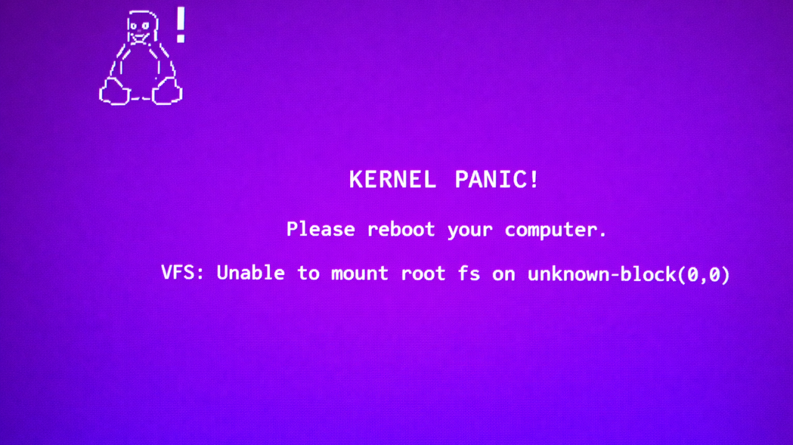

# 1. 시스템 구성 정보 확인

시스템에서 발생하는 문제점을 분석하고 확인하기 위해선 현재 구성된 시스템의 정보를 확인할 수 있어야 한다. 사용 중인 커널(`Kernel`)에서 사용 중인 Kernet Version, Parameter, Hardware의 CPU, Memory는 어떤 것을 사용하고 있는지 다양한 정보들을 알아야 알려진 취약점 혹은 버그가 없는지 뿐만 아니라 하드웨어의 문제가 없는지를 확인할 수 있다.

```bash
uname -a
```

위의 명령어를 입력하면 `Linux MAIN-DESKTOP 6.18.58.1-microsoft-standard-WSL2 #1 SMP PREEMPT_DYNAMIC Tue Oct 27 00:24:11 UTC 2026 x86_64 GNU/Linux`와 같은 결과를 출력을 해주는데 현재 작성자의 환경을 기준으로 `[환경] [장비 이름] [버전-제조사-버전 카테고리-구성 방식] [날짜] [프로세스 구성 타입]`들을 확인할 수 있다. 이는 각기 사용자마다 출력되는 정보들이 다르기 때문에 필히 한 번은 명령어를 실행해 맞는 구성 환경을 확인 하는 것이 필요하다.

## 1.1 세부적인 시스템 부팅 정보 확인

단순히 `uname -a`만으로 확인하기에 정보가 없어 Windows나 MacOS처럼 부팅 시 실행되는 과정에 대한 데이터를 확인할 수 있도록 명령어를 제공해준다. 커널 링 버퍼에서 커널 메시지를 표시해 하드웨어, 드라이버 및 부팅 문제를 진단하는 데 도움을 주는 리눅스 명령어로 장치 초기화, 오류, 경고와 같은 저수준 시스템 이벤트를 보여주어 사람이 쉽게 읽을 수 있는 타임스템프, 실시간 모니터랑을 지원한다.

```bash
dmesg
```

> [!NOTE]
> **dmesg**의 결과는 [linux-boot-dmesg](./example/linux-boot-dmesg.txt)에서 확인할 수 있다.

> [!WARNING]
> WSL2 Linux Ubuntu의 Boot Log는 내용이 방대하기 때문에 details로 options처럼 선택적처럼 열람할 수 있게 해놨다. 단순히 로그를 보고 싶은 것이 아니라면 `grep`을 통해서 필요한 정보들만 출력되게 하는 방식을 권장하고, tail처럼 파일에 대한 실시간 업데이트되는 방식을 택하기엔 적합하지 않은걸로 생각한다.


수 백줄의 로그를 확인 하기에는 사용자는 필요로 하지 않는 데이터들도 포함되기 때문에 `grep`을 통해서 필요한 데이터들만 출력되게 하여 확인할 필요가 생긴다.

```bash
dmesg | grep -i kernel | more
```

```bash
[    0.000000] KERNEL supported cpus:
[    0.027067] Booting paravirtualized kernel on Hyper-V
[    0.028802] Kernel command line: initrd=\initrd.img WSL_ROOT_INIT=1 panic=-1 nr_cpus=16 hv_utils.timesync_implicit=1 printk.devkmsg=on page_reporting.page_reporting_order=5 hv_storvsc.storvsc_max_hw_queues=4 console=hvc0 debug pty.legacy_count=0 WSL_ENABLE_CRASH_DU
MP=1
[    0.028865] Unknown kernel command line parameters "WSL_ROOT_INIT=1 WSL_ENABLE_CRASH_DUMP=1", will be passed to user space.
[    0.090285] mitigations: Enabled attack vectors: user_kernel, user_user, guest_host, guest_guest, SMT mitigations: auto
[    0.090288] Speculative Return Stack Overflow: WARNING: See https://kernel.org/doc/html/latest/admin-guide/hw-vuln/srso.html for mitigation options.
[    0.090313] x86/fpu: Supporting XSAVE feature 0x1000: 'Control-flow Kernel registers (KVM only)'
[    0.125290] Memory: 15648972K/16056956K available (18792K kernel code, 2626K rwdata, 13312K rodata, 4120K init, 3304K bss, 398080K reserved, 0K cma-reserved)
[    0.342256] Freeing unused kernel image (initmem) memory: 4120K
[    0.342512] Write protecting the kernel read-only data: 34816k
[    0.343692] Freeing unused kernel image (text/rodata gap) memory: 1684K
[    0.344538] Freeing unused kernel image (rodata/data gap) memory: 1024K
```

#### 지원하는 옵션

| OPTION     | Description                          |
| ---------- | ------------------------------------ |
| `-H`       | 사람이 읽을 수 있는 타임시탬프       |
| `-T`       | 타임스탬프를 읽기 쉬운 형식으로 변환 |
| `-l`       | 로그 레벨별 필터링 [err, warn, info] |
| `-k`       | 커널 전용 메시지                     |
| `-f`       | 시설별 필터링                        |
| `--follow` | 실시간 모니터링                      |
| `-L`       | 출력 컬러 적용                       |
| `--clear`  | 링 버퍼 지우기                       |

## 1.2 커널 패닉 디버그 로그 저장 설정 확인

<p align="center">
  
</p>
<출처: https://www.linkedin.com/pulse/learning-hard-way-real-life-linux-kernel-panic-levi-santos-rocha-5psxe>

커널 진입 단계에서 부팅 시 다양한 이유로 알 수 없는 방식으로 패닉 상태에 빠지는 경우가 발생한다.

> [!NOTE]
> 현재 작성자의 Work-Desktop은 매일 부팅 시 커널 진입 단계에서 패닉이 발생하여 문제 발생 원인을 찾고자 지속적인 로그를 확인할 수 있는 방법을 찾고 있다. 하지만 늘 그렇듯 해결 하기 위해선 넓은 범위에서 좁은 범위까지 도달할 수 있는 방법을 알아야 더나은 트러블 슈팅이 가능할거 같다는 견해다.

```bash
cat /proc/cmdline
```

```bash
initrd=\initrd.img WSL_ROOT_INIT=1 panic=-1 nr_cpus=16 hv_utils.timesync_implicit=1 printk.devkmsg=on page_reporting.page_reporting_order=5 hv_storvsc.storvsc_max_hw_queues=4 console=hvc0 debug pty.legacy_count=0 WSL_ENABLE_CRASH_DUMP=1
```

> [!NOTE]
> * `/proc/cmdline`에서 필수로 `WSL_ENABLE_CRASH_DUMP=1`와 같은 Crash dump가 설정 되어 있는지 확인하면 나중 패닉에 빠지더라도 해결 하기 위한 접근을 도와줄 수 있는 유용한 정보라고 보고있고, 현재 예시는 WSL2 기준으로 보여주는 것이기 때문에 실제 가상화 머신에서 실행했을 때와 다르게 출력이 나오겠지만 궁극적인 목표는 (`wsl.exe`, `wslservice.exe`, `wslhost.exe`)와 같은 비정상적인 종료로 패닉오는 문제를 해결하기 위함으로 생각한다.  
> * 결과에 파일로 내용을 저장해 확인하고자 하는 경우에 `>> : 기존 파일이 있더라도 내용을 덮어 쓰지 않고 새로운 줄에 추가` 혹은 `> : 덮어쓰기`를 통해서 저장 후에 본인 환경에서 확인하면 된다. 다만 Linux의 독립된 환경에서는 `mnt`가 기본적으로 되어 있지 않기 때문에 별도의 mnt를 활용하거나 확장 프로그램 통해서 저장하는 방법도 존재한다. 

특히 `[    0.125290] Memory: 15648972K/16056956K available (18792K kernel code, 2626K rwdata, 13312K rodata, 4120K init, 3304K bss, 398080K reserved, 0K cma-reserved)`와 같은 로그에는 실제 가용중인 환경의 물리적인 메모리를 뜻하고 가용 가능한 메모리의 크기를 보여준다. free 명령과 비교시 다소 다른 크기를 보여주는데 이는 부팅 과정에서 사용된 일부 메모리들이 부팅 완료 후에 반환되기 때문이다.

# 2. 하드웨어 정보 확인

> [!WARNING]
> ```bash
> dmidecode -t system
> ```
>
> ```bash
> # CMD Result
> Scanning /dev/mem for entry point.
> Can't read memory from /dev/mem
> ```

## 2.1 CPU 정보 확인

```bash

```

---

# ETC. 참고 자료

* [Linux dmesg cmd](https://www.geeksforgeeks.org/linux-unix/how-to-use-the-dmesg-command-on-linux/)